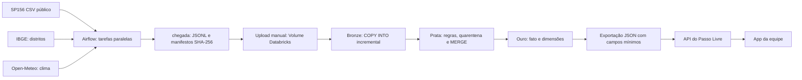

# Big Data Architecture & Data Integration

Comece pela [Ficha Técnica](FICHA_TECNICA.md). Autores: Guilherme Rezende Bezerra RM 98508; Gustavo Brisqui RM 97969; Matheus Brisqui RM 97892.

## Perguntas do produto

1. Em quais distritos se concentram solicitações relacionadas à acessibilidade?
2. Quais serviços aparecem com maior frequência?
3. Qual a proporção finalizada e o tempo administrativo de finalização?
4. Como as solicitações se distribuem em dias de faixas diferentes de chuva?
5. Onde há maior volume de solicitações abertas ou em andamento na fotografia publicada?

## Fluxo e arquitetura



## Fontes

| Origem | Formato e coleta | Uso e limite |
|---|---|---|
| [SP156](https://dados.prefeitura.sp.gov.br/dataset/dados-do-sp156) | CSV original → JSONL; nova consulta diária; publicação trimestral | Solicitações de abril a junho de 2026, filtradas por assunto/serviço. Licença CC0 informada no catálogo. Atualização diária da coleta não significa atualização diária da publicação. |
| [IBGE](https://servicodados.ibge.gov.br/api/v1/localidades/municipios/3550308/distritos) | JSON → JSONL; diária | Cadastro de distritos, não estatística de pessoas com deficiência. |
| [Open-Meteo](https://open-meteo.com/en/docs/historical-weather-api) | JSON → JSONL; diária | Reanálise histórica municipal para o mesmo trimestre; CC BY 4.0. Não representa observação em cada calçada. |
| [SPTrans](https://www.sptrans.com.br/desenvolvedores/api-do-olho-vivo-guia-de-referencia/documentacao-api/) | JSON; opcional após configurar token | Busca de paradas de corredores por termo. Sem token, não executada; não é condição para as três fontes já coletadas. |

## Requisitos 01 a 09

1. **Fontes:** três fontes externas reais executadas. Manifestos em `bigdata/evidencias/coletas` e amostras em `bigdata/amostras`.
2. **DAG:** `bigdata/dags/passo_livre_diario.py`, diário às 09h de São Paulo, `catchup=False`, tentativas e logs de falha. Dispare manualmente a primeira coleta hoje.
3. **Paralelismo:** IBGE, clima e SP156 independentes; `conferir_chegada` verifica existência, quantidade e SHA-256. Token opcional no Airflow Variable `SPTRANS_TOKEN`, nunca no código. Notificação atual em log operacional; canal externo não configurado.
4. **Dois lotes:** precisa de dias reais de coleta distintos. Execute hoje e amanhã. Não altere datas do computador ou manifestos. `python -m bigdata.check_collection_days` retorna código 2 enquanto faltar o segundo dia. Consultar dois trimestres hoje não satisfaz esse requisito.
5. **Bronze:** `COPY INTO` carrega arquivos JSONL como texto preservado. Não renomeie arquivos já carregados. A tabela `auditoria_bronze` registra antes, depois e novas linhas. Faça: lote 1 → lote 2 → repetir sem novos arquivos. A terceira execução deve acrescentar zero.
6. **Prata:** conversão segura de datas e coordenadas; vínculo de distrito; seis regras com contagens e quarentena; última versão por chave; `MERGE` pela chave técnica. Contagens por regra podem se sobrepor. A caixa geográfica é uma validação ampla, não o limite oficial do município.
7. **Ouro:** uma fato no grão de solicitação e dimensões de distrito, serviço e data. `ponto_id` nulo até haver associação validada. Cinco consultas executáveis no notebook e na pré-validação local.
8. **Dados pessoais e produto:** endereço, número, CEP e campos livres não saem da coleta; coordenadas arredondadas a três casas na Ouro. Essa minimização não é prova formal de anonimização. App local consome a Ouro por `/v1/painel`; capturas reais em `bigdata/evidencias/app-*.jpg`. A versão pública serve fotografia minimizada da mesma exportação.
9. **Publicação:** README com autoria, instruções e contratos. [Repositório público](https://github.com/guibezerra24/passo-livre) e [painel](https://guibezerra24.github.io/passo-livre/) publicados em 17/11/2026.

## Como executar o Airflow

Na raiz do repositório:

```powershell
docker compose -f compose.airflow.yaml up -d --build
docker compose -f compose.airflow.yaml exec airflow airflow dags list-import-errors
docker compose -f compose.airflow.yaml exec airflow airflow dags unpause passo_livre_diario
docker compose -f compose.airflow.yaml exec airflow airflow dags trigger passo_livre_diario
```

Abra `http://localhost:8080`. O modo standalone gera credenciais locais no volume interno do Airflow. Consulte-as localmente e não inclua em prints, Git ou relatório. O ambiente é apenas de desenvolvimento. Preserve a pasta `chegada` entre as execuções.

Para coletar e testar sem Airflow:

```powershell
python -m bigdata.collect
python -m bigdata.preview
python -m bigdata.check_collection_days
```

Execução direta não substitui os prints Graph/Grid da disciplina.

## Databricks Free Edition: roteiro

1. Criar conta e workspace; abrir o Catalog Explorer.
2. Importar `bigdata/databricks/01_lakehouse.py` como notebook. Usar compute disponível na Free Edition. O catálogo padrão do código é `workspace`; adaptar apenas se seu workspace tiver outro.
3. Executar a célula de criação do schema e dos volumes.
4. No volume `chegada`, criar pastas `ibge`, `clima` e `sp156`. Enviar arquivos JSONL da primeira coleta.
5. Executar o notebook completo; guardar contagens, regras de qualidade, dimensões e resultados das consultas.
6. Após a coleta do outro dia, enviar somente os novos arquivos, mantendo os primeiros. Reexecutar e guardar contagens.
7. Reexecutar sem upload e comprovar incremento zero na Bronze e estabilidade da Prata.
8. Baixar `part-*.json` em `exportacao/mvp`; importar no projeto com `python -m bigdata.import_gold CAMINHO_DO_ARQUIVO`.
9. Abrir o app local, que consome `/v1/painel` sem preview. Fotografar a tela e gerar a fotografia pública com `python -m scripts.build_public`; atualizar GitHub Pages conforme APP.md.

Primeiro lote executado no Databricks em 17/11/2026: Bronze 60.653, Prata/Ouro 60.366, quarentena 100, dimensões 96 distritos / 20 serviços / 91 datas. Cinco consultas e exportação real para a API concluídas. Evidências em `bigdata/evidencias/databricks`. A primeira tentativa falhou porque PATTERN recebeu expressão regular; corrigido para o glob `*.jsonl`, conforme a documentação oficial de COPY INTO. O primeiro upload foi feito pela CLI oficial com OAuth porque a interface rejeitou automação. Registrar upload manual do segundo lote no Catalog Explorer; esse segundo dia continua pendente.

## Interpretação das consultas

- **Q1:** volume registrado por distrito; não comparar como taxa de risco sem denominador e análise de cobertura.
- **Q2:** serviços mais solicitados no recorte; não representa todos os obstáculos de São Paulo.
- **Q3 (impacto):** indicador operacional de finalização administrativa. Não comprova melhora de acessibilidade ou causalidade do Passo Livre. O impacto futuro exige confirmação da remoção pelos usuários.
- **Q4:** associação descritiva entre data de abertura e chuva; abertura não é data de surgimento do problema. Faixas com números diferentes de dias não devem ser interpretadas como taxas.
- **Q5:** solicitações abertas/em andamento na publicação; não é situação atual em tempo real. Canceladas e indeferidas não contam como pendentes nem como resolvidas.

## Evidências para o PDF final

O PDF desta preparação identifica o que foi executado e o que ainda está pendente. Antes de entregar, complementar na ordem pedida: integrantes; produto e perguntas; diagrama; fontes; requisitos 01–09; Graph/Grid concluídos; contagens Bronze em três execuções; cinco consultas com resultados e interpretação; conclusão e GitHub público.

## Limitações de identidade e atualizações

Como não há protocolo no CSV, duas linhas idênticas são preservadas como solicitações distintas. A identidade usa UUID do recurso + posição da linha. Isso evita eliminar relatos diferentes por deduplicação agressiva, mas não é chave de negócio estável entre republicações. O arquivo original tem SHA-256 registrado. Se a prefeitura reordenar as linhas, interrompa a comparação incremental e reconcilie a publicação; para produção, obter identificador estável junto à fonte.
