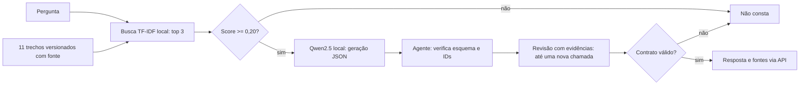

# Generative AI for Engineering - Passo Livre

Guilherme Rezende Bezerra - RM 98508;
Gustavo Brisqui - RM 97969;
Matheus Brisqui - RM 97892

## Ficha Técnica e tarefa

[Ficha Técnica comum](FICHA_TECNICA.md). A IA responde perguntas documentais de acessibilidade e mobilidade em São Paulo, cita IDs rastreáveis e recusa perguntas sem suporte. Não calcula trajetos seguros nem informa condições em tempo real. Domínio: mobilidade.

Modelo: **Qwen2.5 1.5B Q4_K_M**, local no Ollama. Licença Apache 2.0. Máquina de execução: Windows, aproximadamente 16 GB RAM, NVIDIA GTX 1650 4 GB; Python 3.13.16. Os pesos são baixados separadamente. Não houve fine-tuning de pesos ou LoRA; escolhemos a alternativa de especialização por **agente** da rubrica.

## Pipeline

O RAG simples usa busca, limiar e primeira geração. O agente acrescenta validação determinística do contrato/citações e revisão limitada pela mesma LLM; se a revisão falha, recusa. Esse laço é limitado a duas gerações por pergunta, não tem acesso a navegador, prefeitura, shell ou ferramentas de escrita. O baseline usa o mesmo modelo, temperatura, seed, limite de tokens e contrato JSON, sem documentos.

## Base e direitos de uso

| Fonte | Formato | Licença/condição | Trechos |
|---|---|---|---:|
| [Lei Brasileira de Inclusão](https://www.planalto.gov.br/ccivil_03/_ato2015-2018/2015/lei/l13146.htm), arts. 46, 47, 53, 55 e 63 | Paráfrases editoriais em JSONL | Texto legal público; verificar redação vigente na fonte | 6 |
| [SPTrans: perguntas e respostas](https://www.sptrans.com.br/perguntas-e-respostas/?sobre=fiscalizacao) | Resumos editoriais curtos | Licença de republicação não identificada; atribuição e resumo, sem cópia extensa | 3 |
| Políticas do protótipo | Texto autoral em JSONL | Conteúdo do projeto | 2 |

Total: **11 trechos**. Arquivos `base/trechos.jsonl` e `base/fontes.json` incluem ID, título, texto, URL, formato, condição de uso e data de revisão. A NBR 9050 não está na base; perguntas de dimensões normativas devem ser recusadas. As paráfrases são um corpus inicial pequeno, não uma reprodução completa das normas.

## Avaliação e limiar

Separação: 8 perguntas de validação para calibração e 16 perguntas de teste, sendo 10 respondíveis e 6 sem resposta na base. O gabarito contém fonte esperada e grupos de conceitos aceitos. Os dois conjuntos foram escritos para este protótipo; não são amostra independente de usuários.

Busca: recall@1 = **1,00** e recall@3 = **1,00** nas 10 perguntas respondíveis, antes do filtro de limiar. São métricas de recuperação sobre corpus pequeno, não precisão de respostas. O caso T04 recupera o trecho correto e ainda assim é recusado pelo limiar.

O limiar 0,20 maximiza a acurácia balanceada da validação (0,875); em empate, favorece cobertura escolhendo o menor limiar. O piloto tinha escolhido 0,40 em empate e recusava demais. Preservamos o piloto em `avaliacao/piloto`. A regra de desempate foi revisada após diagnóstico exploratório; portanto, este resultado final não deve ser apresentado como teste cego ou validação estatística independente. O arquivo `limiar.json` contém todos os candidatos e scores.

## Placar medido

| Configuração | Acerto por conceitos | Citação/recusa conforme gabarito | Resposta indevida nos 6 casos fora da base | Latência média (s) |
|---|---:|---:|---:|---:|
| sem_contexto | 37.50% | 31.25% | 16.67% | 1.36 |
| rag | 81.25% | 75.00% | 0.00% | 1.16 |
| agente | 81.25% | 81.25% | 0.00% | 1.82 |

Execução: 2026-11-17T11:50:06.582949+00:00. 48 avaliações finais: mesmas 16 perguntas nas três configurações. As respostas completas, tentativas de reparo, duração e hash da base estão em `avaliacao/respostas.jsonl`. O notebook apresenta as saídas salvas.

**Leitura dos resultados:** RAG e agente melhoraram o acerto por conceitos de 37,5% para 81,25%. O agente não superou o RAG nessa métrica e acrescentou custo/latência. Não se deve afirmar que a especialização venceu o RAG. Ela corrigiu o contrato de recusa em alguns casos, mas não resolveu os erros semânticos.

**Limite das métricas:** palavras-chave e IDs de citação não comprovam fundamentação. A revisão assistida das respostas detectou duas respostas de cada configuração com contexto (T06 e T07) que passam por conceitos, mas contêm informação não sustentada ou atribuição incorreta. Com esse critério mais estrito, RAG e agente ficam em **11/16 = 68,75%**. A revisão é do assistente de desenvolvimento e precisa de conferência da equipe; não foi realizada por avaliador humano independente.

Zero respostas com `status=respondido` nos casos fora da base não significa zero alucinações no conjunto. O modelo ainda pode inserir afirmações sem suporte em perguntas respondíveis ou até usar `nao_consta` com texto contraditório. A taxa reportada é apenas um indicador restrito de extrapolação, não uma taxa universal de alucinação.

Latência inclui recusas sem chamar a LLM. Tempos foram medidos sequencialmente e variam com aquecimento/cache; não constituem benchmark de produção. JSON válido na primeira geração é medido apenas nas perguntas que chamaram o modelo e significa aderência ao esquema, não verdade factual.

## Cinco erros reais, causas e correções

### 1. Afirmação normativa sem suporte (sem_contexto / T12)

**Pergunta:** Quantos centímetros deve ter a faixa livre da calçada segundo a NBR 9050?

**Observação:** O modelo apresentou um número de largura de calçada embora a NBR não integre a base. A referência gerada não foi recuperada.

**Correção proposta:** Recusar números normativos fora da base; incluir apenas edição licenciada, com rastreabilidade e teste específico.

### 2. Complemento não fundamentado (rag / T06)

**Pergunta:** Sites de empresas brasileiras e órgãos de governo devem oferecer acessibilidade?

**Observação:** Acertou a obrigação geral de acessibilidade, mas acrescentou suporte de assistentes virtuais como se estivesse no trecho. O avaliador por palavras-chave marcou acerto.

**Correção proposta:** Avaliar cada afirmação contra a evidência; restringir resposta ao trecho e revisar o conjunto de avaliação semântica.

### 3. Troca do sujeito da limitação (agente / T07)

**Pergunta:** Quais informações preciso fornecer para reclamar de um ônibus na SPTrans?

**Observação:** A ausência de horários na base do Passo Livre foi atribuída ao site/canal SPTrans, alterando o sentido do documento. A revisão do agente não corrigiu.

**Correção proposta:** Separar política local de fonte externa em metadados; verificar quem é o sujeito da afirmação na revisão.

### 4. Recusa por limiar (rag / T04)

**Pergunta:** Como a acessibilidade se relaciona à independência e à cidadania?

**Observação:** O trecho correto foi o primeiro resultado, mas score 0,141 ficou abaixo do limiar 0,20.

**Correção proposta:** Ampliar validação com paráfrases; comparar embeddings e reranking; não reduzir o limiar só para corrigir este teste.

### 5. Recusa indevida apesar da evidência (agente / T09)

**Pergunta:** Em que horário mulheres e idosos podem desembarcar fora dos pontos segundo a SPTrans?

**Observação:** O trecho SPFORA traz o horário, mas a geração recusou e incluiu fontes. Após reparo inválido, o agente aplicou recusa segura.

**Correção proposta:** Separar trechos longos em unidades de informação, testar modelo maior e reforçar extração fundamentada; registrar custo e impacto.

As saídas problemáticas são material de avaliação, não orientação ao usuário. O arquivo `cinco_erros_analisados.json` preserva a resposta exata de cada caso.

## Segurança, LGPD e integração

Inferência local; não enviar nome, CPF, telefone ou condições médicas no prompt. A API não grava perguntas de uso real em disco. Somente perguntas sintéticas de avaliação estão versionadas. `API_TOKEN` opcional no ambiente local; definir token e HTTPS antes da publicação. Servidor configurado para loopback no README; limite de tamanho da pergunta e uma geração concorrente. Documentos são dados, não instruções; teste T15 cobre uma tentativa simples de injeção, sem demonstrar resistência completa.

Contrato: `POST /v1/assistente` recebe `pergunta` e `modo`; retorna `answer.status`, `answer.resposta`, `answer.fontes`, fontes detalhadas e latência. Swagger em `/docs`. A tela integrada está em `/`, com fontes clicáveis, limites e recusas. Foi testada com uma resposta fundamentada sobre direito ao transporte e uma recusa na pergunta sobre reclamação de ônibus quando a validação de fontes falhou. A versão pública GitHub Pages não executa a LLM: a consulta funciona na instalação local, conforme APP.md.

## Reprodução

Seguir o README; executar `python -m genai.evaluate --retrieval-only` e `python -m genai.evaluate`. Uma nova execução substitui o placar final e preserva a execução anterior em `piloto`; arquive experimentos importantes antes de repetir. Temperatura 0, seed 42, contexto 4096 e limite 400 tokens. Versões do ambiente estão em `requirements-executado.txt`.

## Conclusão e entrega

O experimento mostra benefício da recuperação de contexto sobre o modelo sem contexto neste conjunto. Também mostra que uma revisão pela mesma LLM não garante respostas fundamentadas. Prioridades: corpus maior com fontes licenciadas, avaliação independente, modelos mais capazes e verificação de afirmações. Não apresentar o protótipo como orientação jurídica definitiva ou roteador acessível certificado.

**Links:** [GitHub público](https://github.com/guibezerra24/passo-livre) e [painel público](https://guibezerra24.github.io/passo-livre/). **Pendente:** vídeo de demonstração com assistente local e análise dos experimentos. Roteiro em `docs/ROTEIRO_DEMONSTRACAO.md`.
