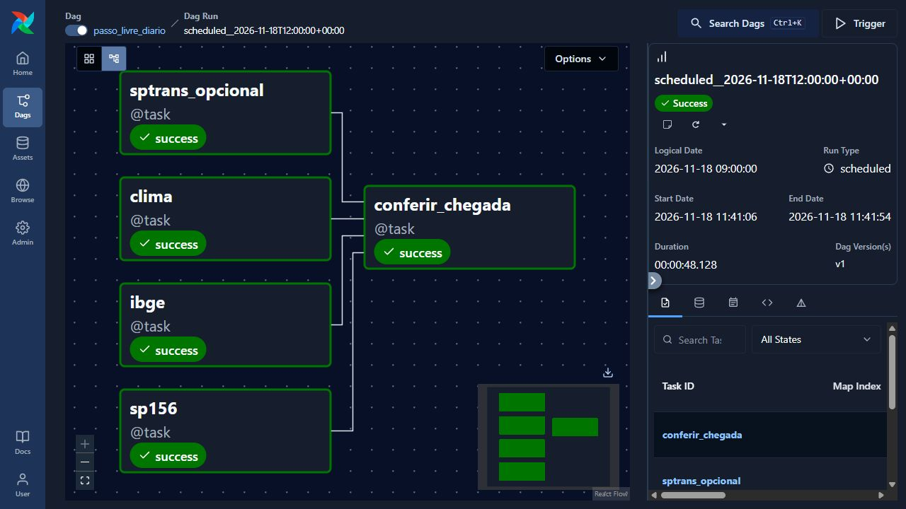
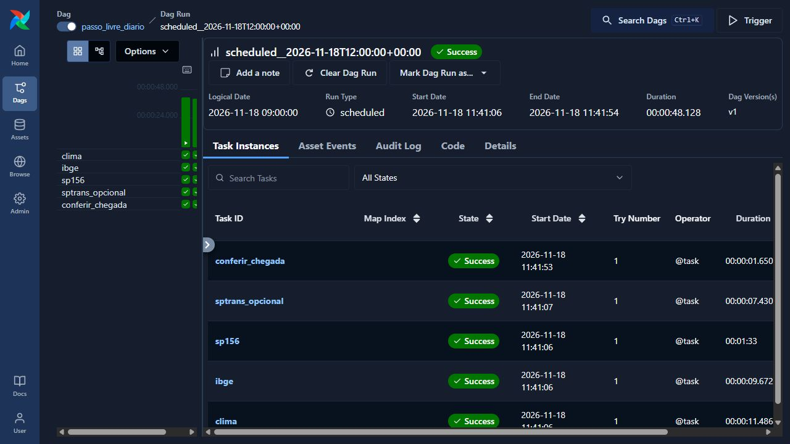

# Segundo dia de coleta — 18/11/2026

**Coleta, carga e reexecução concluídas no Databricks em 18/11/2026.** Bronze: 60.653 → 121.306 após o segundo lote; reexecução: 121.306 → 121.306, incremento zero. Prata/Ouro: 60.366 solicitações. O integrante realizou o upload manual dos três arquivos e a conferência dos arquivos remotos confirmou os hashes locais.

## Execução comprovada

Airflow: `scheduled__2026-11-18T12:00:00+00:00`, estado `success`. Agendamento diário às 9h de São Paulo. Nesta data o computador estava desligado no horário previsto: a execução começou às **11:41:06** e terminou às **11:41:54**, após o serviço ser iniciado.

IBGE, clima e SP156 executaram em paralelo, seguidos de `conferir_chegada`. `sptrans_opcional` retornou `nao_configurada`; não houve coleta de SPTrans.

## Lote selecionado

| Pasta no Volume | Arquivo | Linhas |
|---|---|---:|
| `chegada/ibge` | `ibge_20261118T144111342047Z.jsonl` | 96 |
| `chegada/clima` | `clima_20261118T144112141339Z.jsonl` | 91 |
| `chegada/sp156` | `sp156_20261118T144151581097Z.jsonl` | 60.466 |

Total: **60.653 linhas**. Os nomes contêm horário UTC; os manifestos registram origem, instante de coleta e SHA-256. Os três hashes foram conferidos contra os arquivos selecionados. Uma execução manual adicional ocorreu no mesmo dia; seus arquivos não foram selecionados para este lote e ela não constitui um terceiro dia de coleta.

O CSV original do SP156 manteve o mesmo SHA-256 do dia 17. Trata-se de nova coleta real de uma publicação histórica de abril a junho de 2026, não de 60.466 novas solicitações. A chave técnica depende da posição da linha no recurso; a igualdade do arquivo original foi verificada antes de preparar a segunda carga.

## Procedimento executado e reprodução

1. No Catalog Explorer, abrir `workspace → passo_livre → Volumes → chegada`.
2. Enviar pela interface cada JSONL para sua pasta `ibge`, `clima` ou `sp156`, preservando os arquivos de 17/11. O briefing pede envio manual pela interface; o primeiro lote utilizou a CLI oficial e essa diferença está documentada.
3. Conferir os três arquivos e executar `01_lakehouse` no Databricks.
4. Registrar o incremento real da Bronze, contagens Prata/Ouro, regras de qualidade e cinco consultas.
5. Reexecutar sem novos arquivos e verificar incremento zero. Não registrar contagens esperadas como se fossem observadas.
6. Exportar a Ouro, importar no app, atualizar a fotografia pública e finalizar o PDF com os resultados efetivamente obtidos.

A quarentena é avaliada sobre as versões de linhas na Bronze. Depois de dois lotes do mesmo recurso, contagens de linhas rejeitadas podem aumentar sem representar mais solicitações distintas. Não somar violações de regras como se fossem rejeitados únicos.

## Resultado final

Os dois envios foram preservados, a carga e a reexecução terminaram com sucesso, as cinco consultas foram exportadas e a Ouro foi importada para o app. Auditorias completas em [resultados.json](../bigdata/evidencias/databricks/resultados.json); inventário e hashes em [lote2_upload_verificado.json](../bigdata/evidencias/databricks/lote2_upload_verificado.json). O primeiro envio foi via CLI oficial; apenas o segundo foi manual pela interface.
